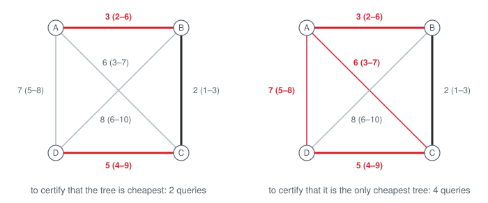

# optimum-certificates

The edge costs of a network are known only as ranges, and measuring one
exactly costs something. Which measurements are enough to be sure that a
spanning tree is the cheapest one?

This library computes a cheapest such set of measurements, for spanning trees
and for any other matroid, and for two versions of the question:

| mode | after the queries it is certain that |
|---|---|
| `basis` | one particular solution is optimal |
| `family` | the set of all optimal solutions is exactly what it is now |

<p align="center"></p>

Each edge shows its actual cost and the range known in advance. Thick edges
are the cheapest tree; red edges are the ones to measure. Two measurements
show that no tree can be cheaper. Two more are needed to show that no other
tree can cost the same.

## Use

```python
from optcert import Problem, graphic

network = graphic({"AB": ("A", "B"), "BC": ("B", "C"), "CD": ("C", "D"),
                   "DA": ("D", "A"), "AC": ("A", "C"), "BD": ("B", "D")})
problem = Problem(
    network,
    weights={"AB": 3, "BC": 2, "CD": 5, "DA": 7, "AC": 6, "BD": 8},
    areas={"AB": (2, 6), "BC": (1, 3), "CD": (4, 9), "DA": (5, 8), "AC": (3, 7), "BD": (6, 10)},
)

problem.certificate("basis").queries    # {'AB', 'CD'}
problem.certificate("family").queries   # {'AB', 'AC', 'CD', 'DA'}
problem.certifies({"AB"}, "basis")      # False
```

An area is an interval or a list of intervals; an element without an area is
known exactly. Query costs default to 1 and can be given per element.
`sense="max"` maximises. Besides `graphic` there is `uniform(elements, k)` for
choosing `k` items, and `Matroid(elements, independent)` accepts any
independence test. Arithmetic is exact (`fractions.Fraction`). There are no
dependencies.

```
$ python -m optcert examples/network.json
to certify one optimal solution: query AB, CD (cost 2)
to certify all optimal solutions: query AB, AC, CD, DA (cost 4)
```

## Method

Take an optimal basis and every way of exchanging one of its elements for one
outside it. Each exchange constrains only its two elements: one of them must
be queried, or a specific one, or both, or neither. The forced elements
together with a minimum-cost vertex cover of the remaining pairs, a bipartite
graph, are a cheapest certificate. [docs/note.md](docs/note.md) has the
conditions and the proofs.

## Checks

`python verify.py` evaluates the two definitions directly on random small
matroids (graphs, uniform, binary), by enumerating every world and every set
of queries, and compares with the library.

| areas | instances | with tied optima | answers compared | differences |
|---|---|---|---|---|
| finite sets | 5,000 | 1,160 | 112,614 | 0 |
| unions of intervals, on a grid | 5,000 | 276 | 70,958 | 0 |

The minimum costs agree on all instances. CI repeats the run.

## Scope

- `basis` mode implements known results: Erlebach and Hoffmann [1] for
  spanning trees, Diwan, Hellerstein, Megow and Schlöter [2] for matroids. No
  public implementation of either was found (GitHub and web search,
  2026-11-17).
- When several bases are optimal, they can differ in what it costs to
  certify them. `basis` mode picks one by the contraction and deletion rules
  of [2] instead of trying them all. The rules were implemented from the
  paper's description and are checked against trying every optimal basis.
- `family` mode answers a stronger question that [1] and [2] do not treat.
  The condition is a short variation of the same argument. Its proof in the
  note is checked by the enumeration above and by nobody else, and it is not
  claimed to be new.
- Areas are closed. `basis` mode gives the same answer for open intervals;
  `family` mode does not.
- The queries are chosen knowing the actual weights, as in the verification
  problem of [1] and [2]. Choosing queries before seeing any answer is a
  different problem, studied in [3] and [4].

## References

1. T. Erlebach, M. Hoffmann. Minimum spanning tree verification under
   uncertainty. WG 2014.
2. H. Diwan, L. Hellerstein, N. Megow, J. Schlöter. Optimal verification of a
   minimum-weight basis in an uncertainty matroid. STACS 2026.
   [arXiv:2512.17116](https://arxiv.org/abs/2512.17116)
3. A. Merino, J. A. Soto. The minimum cost query problem on matroids with
   uncertainty areas. ICALP 2019.
   [arXiv:1904.11668](https://arxiv.org/abs/1904.11668)
4. C. Dürr, A. Merino, J. A. Soto, J. Verschae. Set selection with uncertain
   weights: non-adaptive queries and thresholds.
   [arXiv:2404.17214](https://arxiv.org/abs/2404.17214)

## License

MIT
